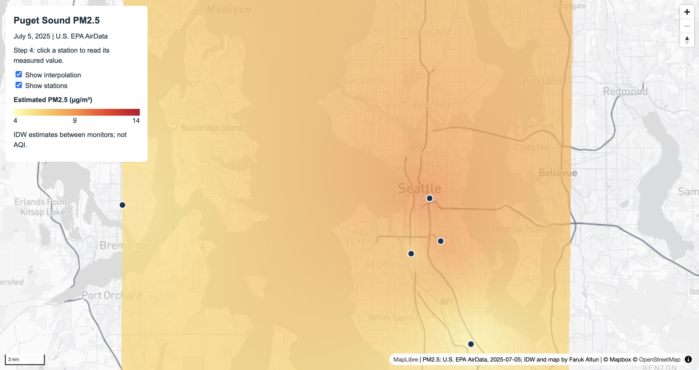
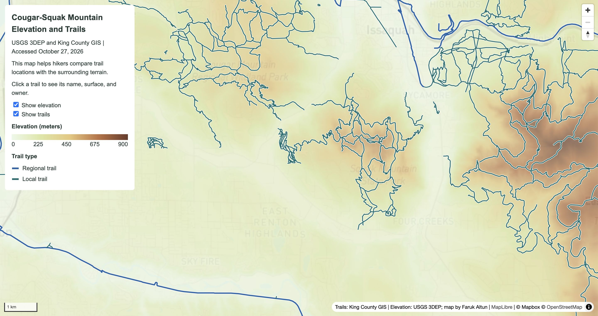

# Lab 3: Map Design and Tile Generation

## Purpose

This lab contains two web maps that combine local raster tile pyramids with interactive vector data.

The guided map shows estimated PM2.5 concentrations across the Puget Sound region on July 5, 2025. It is meant to help a general audience compare the interpolated surface with the measured values at individual EPA monitoring stations.

The independent map shows elevation and trails around Cougar and Squak Mountains. It is meant for hikers who want to compare trail locations, trail types, and surfaces with the surrounding terrain.

## Guided PM2.5 map

The guided study area covers central Puget Sound from approximately Tacoma to Marysville, including Seattle and Bremerton. The exported bounds are west/east -122.75/-122.05 and south/north 47.10/48.15.

The basemap was designed in Mapbox Studio using a copy of the Mapbox Light style. I excluded the five required commercial POI classes and used darker neutral gray for the major freeway network while keeping other roads lighter. I published the style and exported it from QGIS as `assets/mapbox-guided`.

The PM2.5 observations came from U.S. EPA AirData. The file contains 11 monitoring sites with daily summary measurements for July 5, 2025. I loaded the coordinates in EPSG:4326, saved a projected copy in EPSG:32610, and created an IDW interpolation using a distance coefficient of 2 and a 250 meter pixel size. I styled the raster with a continuous five-color ramp from 4 to 14 µg/m³ and exported it separately as `assets/pm25-guided` with a transparent background.

The monitoring stations remain as GeoJSON vector points above the two raster layers. Clicking a station reports the station name, measured PM2.5 value, units, date, and station ID.

## Independent elevation and trails map

The independent study area covers Cougar Mountain and Squak Mountain in King County. The exported bounds are west/east -122.20/-121.96 and south/north 47.42/47.58.

The second Mapbox Studio style uses warm neutral land, pale blue water, pale green parks, subdued roads, and fewer commercial POIs. I exported it from QGIS as `assets/mapbox-independent`.

The elevation raster came from the USGS 3D Elevation Program. The downloaded raster uses EPSG:3857, has a 1600 by 1600 cell grid, and ranges from approximately 0 to 897 meters. I styled the raster with a continuous ramp at 0, 225, 450, 675, and 900 meters, then exported it separately as `assets/elevation` with a transparent background.

The trail lines came from King County GIS. The GeoJSON contains 680 trail features. The web map uses data-driven colors to distinguish regional and local trails. Clicking a trail reports its name, park or site, trail type, surface, and owner.

## Tile export settings

All four tile pyramids use 256-pixel PNG files, the XYZ convention, and zoom levels 8 through 12. The two basemaps were exported with an opaque background. The PM2.5 and elevation overlays were exported with transparent backgrounds so the basemap remains visible below them.

## Raster estimates and vector measurements

The raster tiles are pre-rendered snapshots. They support fast panning, zooming, and layer switching, but they do not keep the original feature IDs, raster values, or attribute tables. A user cannot click a colored PM2.5 pixel to recover a measured concentration. The PM2.5 surface estimates conditions between monitoring stations, while the station popups report measured daily summary values. In the independent map, the elevation raster shows continuous terrain, while the trail vectors preserve individual trail names and attributes for interaction.

## Data sources

- [Mapbox](https://www.mapbox.com/) and [OpenStreetMap](https://www.openstreetmap.org/copyright) for both basemaps
- [U.S. EPA AirData](https://aqs.epa.gov/aqsweb/airdata/download_files.html) for PM2.5 observations
- [USGS 3D Elevation Program](https://elevation.nationalmap.gov/arcgis/rest/services/3DEPElevation/ImageServer) for elevation
- [King County GIS trails](https://services.arcgis.com/Ej0PsM5Aw677QF1W/ArcGIS/rest/services/Trails_in_King_County/FeatureServer) for trail lines

## Screenshots

### Guided PM2.5 map

### Independent elevation and trails map

## AI use disclosure

I was unable to attend the class or quiz section because I was sick. I used AI assistance (ChatGPT 5.6 Sol-ExtraHigh) to help me work through and complete this assignment.
